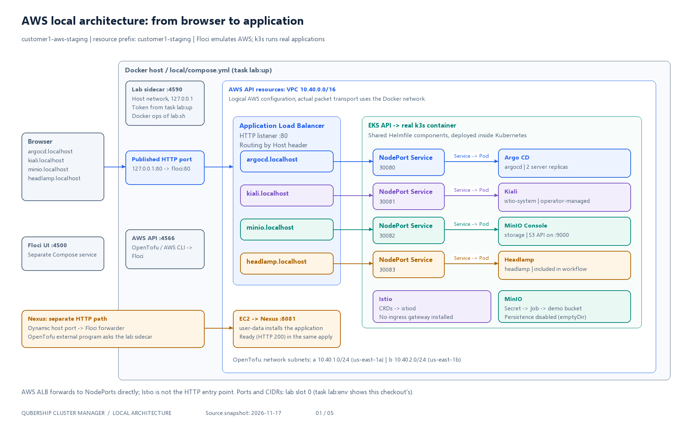

# Architecture diagrams

These pages cover the managed Floci deployments. For the VM-based path, see [Kubemarine stack dependencies](../architecture.md#kubemarine-stack-dependencies).

Open [atmos-local-demo.drawio](atmos-local-demo.drawio) in diagrams.net / draw.io using **File → Open from → Device**.
The document contains five editable pages. Nodes, labels, and connectors are editable; the pages are not flattened images.
The PNG files provide previews without a diagram editor.

## Pages

| Page | Contents | Preview |
|---|---|---|
| 01 — AWS architecture | Browser, Floci, ALB host rules, NodePorts, Kubernetes applications, and separate Nexus access | [page-01.png](page-01.png) |
| 02 — AWS workflows | Sequential infrastructure/access, parallel Nexus/platform branches, OpenTofu-managed readiness in one apply, and parallel destroy | [page-02.png](page-02.png) |
| 03 — Files and data | Atmos discovery, explicit imports, catalogs, stack overrides, component implementations, state outputs, and Helm values | [page-03.png](page-03.png) |
| 04 — AWS ports and access | Route files, rule priorities, health checks, security groups, Secret usage, and Headlamp RBAC | [page-04.png](page-04.png) |
| 05 — Azure local environment | Separate emulator startup, access preparation, deployment/destruction, port forwarding, and emulator limitations | [page-05.png](page-05.png) |

## Scope and source files

These diagrams describe the repository configuration as reviewed on **2026-11-17**.
They do not query live resources when opened and are not evidence that a particular environment is currently running.

| Topic | Repository sources |
|---|---|
| Discovery and stack names | [atmos.yaml](../../atmos.yaml) |
| Customer configuration | [AWS staging](../../stacks/customers/customer1/aws/staging.yaml), [Azure staging](../../stacks/customers/customer1/azure/staging.yaml), and their imported defaults/catalogs |
| Execution and deletion | [AWS workflows](../../workflows/customers/customer1/staging-terraform.yaml), [Azure workflows](../../workflows/customers/customer1/azure.yaml) |
| Nexus readiness | [OpenTofu readiness](../../components/terraform/aws/nexus/readiness.tf), [local endpoint program](../../local/lab.sh) (`nexus-endpoint-json`) |
| AWS routing | [load-balancer implementation](../../components/terraform/aws/load-balancer/) |
| Shared applications | [Helmfile implementations](../../components/helmfile/), [Helmfile catalogs](../../stacks/catalog/helmfile/) |
| Emulator lifecycle | [AWS Compose](../../local/compose.yml), [Azure Compose](../../local/compose.azure.yml), [developer tasks](../../Taskfile.yml), [operator tasks](../../local/Taskfile.yml) |

AWS VPC/subnet outlines represent API resources; local containers communicate over Docker networking.
Nexus has a dynamically published port, resolved by its endpoint program.
Headlamp is installed and removed by the current customer workflows.

Azure startup and deployment are separate operations. `task lab:up CLOUD=azure` does not run
`task -d local prepare-azure`; the workflow runs it in the `access` step after Kubernetes apply. The task asks the lab
sidecar (127.0.0.1:4591 in slot 0, with the token of `task lab:up`) for the cluster's published API port rather than
hardcoding it; slot 0 publishes AKS API servers from port 6600 (`task lab:env` shows the ports of this checkout).
The current Floci Azure load balancer persists ARM configuration but does not forward traffic.
See the [limitations for the pinned emulator revision](https://github.com/floci-io/floci-az/blob/1edf29aded8535febe9de1067604a0a706c8ebd6/docs/services/network.md#scope-and-limitations).
GCP has an inactive stack template and is not shown as a running deployment.

## Updating the diagrams

[build_demo_diagram.py](build_demo_diagram.py) generates the editable document and all five matching PNG previews.
On Linux, macOS and Windows (WSL 2) alike, from the repository root (`devbox shell` brings Task; Docker comes from
the host):

```bash
task docs:diagrams
```

It writes `atmos-local-demo.drawio` and `page-NN.png` here. The generator runs in a pinned container
([Dockerfile](Dockerfile), [compose.yml](compose.yml), [requirements.txt](requirements.txt)) as your uid, offline.
Text uses the bundled Selawik font ([fonts/](fonts/), OFL, Segoe UI metrics), never OS fonts.
So the output is byte-identical on any OS and architecture.
Run it through Task: the compose file needs the uid and gid that Task passes.

To check that the committed files match the generator (they are regenerated into a temporary directory; PNGs are
compared by pixels, the draw.io document by bytes):

```bash
task docs:diagrams:check
```

Without Docker, any Python 3 with Pillow 13 runs the same script, e.g.
`uv run --no-project --with pillow==13.0.0 python docs/diagrams/build_demo_diagram.py`.
The footer date ("Source snapshot") is `SNAPSHOT` in the generator: change it when the content is checked against
the repository again. `DIAGRAM_SNAPSHOT` overrides it for one run, which `--check` then reports as stale:

```bash
DIAGRAM_SNAPSHOT=YYYY-MM-DD task docs:diagrams
```

Outside Task (its container has only the bundled fonts),
`DIAGRAM_FONT_DIR`, `DIAGRAM_FONT` and `DIAGRAM_FONT_BOLD` select other font files; wider fonts such as DejaVu Sans do
not fit the boxes and fail the text-fit check.

The generator checks node bounds, text fit, duplicate node IDs, and connector references.
Content is maintained explicitly against the source files above; it is not automatically inferred from OpenTofu.
Update the generator when configuration changes, regenerate, and inspect every PNG.
Manual edits to the draw.io file are overwritten by regeneration unless also reflected in the generator.


